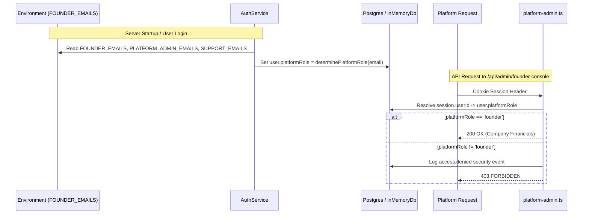

# Phase 20A — Platform RBAC Architecture Report

## 1. Role System Architecture

Workspace OS distinguishes between two orthogonal authorization planes:

1. **Workspace Plane (`workspaceRole`)**:
   - Represents the user's role within an individual organization/tenant workspace.
   - Values: `admin`, `employee`, `intern`.
   - Determined exclusively via `workspace_members` membership or `workspaces.owner_id`.
   - Never carries any platform-wide authority.

2. **Platform Plane (`platformRole`)**:
   - Represents platform-level operating authority across the entire Workspace OS SaaS cluster.
   - Values: `founder`, `platform_admin`, `support`, `none`.
   - Assigned strictly via server bootstrap and trusted environment variables (`FOUNDER_EMAILS`, `PLATFORM_ADMIN_EMAILS`, `SUPPORT_EMAILS`).
   - Default for all regular users and workspace creators: `none`.

---

## 2. Platform Permission Middleware Specifications

File: [`backend/src/middleware/platform-admin.ts`](file:///d:/Development/MAVR/Workspace-MAVR/backend/src/middleware/platform-admin.ts)

### `requireFounder()`
- **Allowed Roles**: `founder`
- **Scope**: Founder Console, MRR, ARR, ARPU, ARPS, Expansion Revenue, Database Backups, System Restoration.
- **Unauthorized Behavior**: Sets HTTP 403 Forbidden with payload:
  ```json
  {
    "error": {
      "code": "FORBIDDEN",
      "message": "Access restricted to Platform Founders only. Workspace Admins are forbidden from platform management."
    }
  }
  ```
  Writes `access.denied` security audit log with IP, User Agent, and Request ID.

### `requirePlatformAdmin()`
- **Allowed Roles**: `founder`, `platform_admin`
- **Scope**: Platform health, global uptime, customer workspace directories, Sentry error observability, system telemetry.
- **Unauthorized Behavior**: 403 Forbidden + `access.denied` audit entry.

### `requireSupport()`
- **Allowed Roles**: `founder`, `platform_admin`, `support`
- **Scope**: Global email deliverability, bounce monitoring, complaint telemetry, read-only customer diagnostics.
- **Unauthorized Behavior**: 403 Forbidden + `access.denied` audit entry.

---

## 3. Account Bootstrapping & Discovery Lifecycle



---

## 4. Code Artifacts Created & Modified

1. [`backend/src/types/index.ts`](file:///d:/Development/MAVR/Workspace-MAVR/backend/src/types/index.ts): Defined `PlatformRole` union and updated `SafeUser`.
2. [`backend/packages/database/schema.ts`](file:///d:/Development/MAVR/Workspace-MAVR/backend/packages/database/schema.ts): Added `platformRole` column and index to `users` table.
3. [`backend/src/config/env.ts`](file:///d:/Development/MAVR/Workspace-MAVR/backend/src/config/env.ts): Added `FOUNDER_EMAILS` and `SUPPORT_EMAILS` env bindings and helper resolvers.
4. [`backend/src/middleware/platform-admin.ts`](file:///d:/Development/MAVR/Workspace-MAVR/backend/src/middleware/platform-admin.ts): Platform RBAC middleware (`requireFounder`, `requirePlatformAdmin`, `requireSupport`).
5. [`backend/src/services/auth-service.ts`](file:///d:/Development/MAVR/Workspace-MAVR/backend/src/services/auth-service.ts): Platform role assignment and bootstrap integration.
6. [`backend/src/routes/phase16-routes.ts`](file:///d:/Development/MAVR/Workspace-MAVR/backend/src/routes/phase16-routes.ts): Route-level platform guards on all founder console routes.
7. [`backend/tests/phase20a-founder-isolation-validation.ts`](file:///d:/Development/MAVR/Workspace-MAVR/backend/tests/phase20a-founder-isolation-validation.ts): 98-assertion automated test suite.
